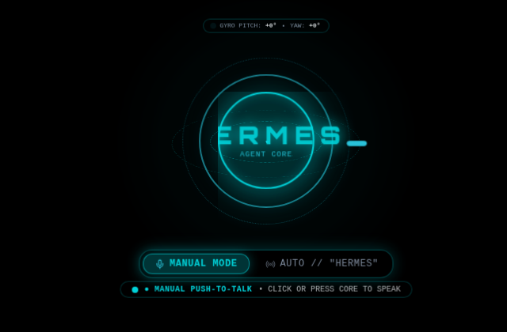

# Hermes Agent OS

Hermes Agent OS is a local-first desktop cockpit for the Hermes Agent runtime. It combines a Next.js interface, a Hermes Gateway running in Kali on WSL2, optional Wispr Flow and Sarvam voice services, and a separate Cesium-based God's Eye viewer.



The screenshots are cropped from the running app to show the interface without host telemetry or conversation content.

## Features

- **HUD and chat modes** with persistent mode selection and automatic resume of the last Hermes conversation.
- **Hermes sessions and commands** backed by the existing `~/.hermes/state.db` session history.
- **Voice input and output** using browser/Electron audio capture, Sarvam Saaras speech-to-text and Bulbul text-to-speech, with browser speech synthesis as a fallback.
- **Wispr Flow integration** for status, configurable push-to-talk, dictation review, manual approval, and auto-execute mode.
- **System controls** for WSL telemetry, process display, audio, maintenance, terminal access, and Windows/WSL bridging.
- **God's Eye** geocoding and 3D globe view, served by the companion project on port `4173`.
- **Windows desktop shell** built with Electron; its main process starts or checks the WSL services and opens the Studio window.

## Screenshots

| Startup sequence | HUD voice controls |
| --- | --- |
|  |  |

## Requirements

- Windows with WSL2 and the `kali-linux` distribution for the bundled desktop workflow.
- Node.js and npm in WSL2 for the Next.js app and companion viewer.
- A working Hermes Agent CLI installation under `~/.hermes`, including its gateway and `state.db`.
- The God's Eye companion project at `~/gods-eye-view` if you want the map viewer.
- Wispr Flow for its Windows dictation integration (optional).
- A Sarvam API key for Sarvam transcription and speech generation (optional).

The service and Windows launcher scripts contain paths for the current installation. If you move the project or use another WSL account, update `scripts/manage-services.sh`, `windows/Hermes-Launcher.ps1`, and `windows/main.js` to match your paths and distribution.

## Run in WSL

From the repository root:

```bash
npm ci
npm run dev
```

The Studio dev server listens on port `3001`. For a production build:

```bash
npm run typecheck
npm run lint
npm run build
npm start
```

`npm start` runs the production server on port `3001`. The service manager starts the production server when `.next/` exists and falls back to the dev server when it does not.

## Start and manage the WSL services

From the project root in Kali WSL:

```bash
scripts/manage-services.sh start
scripts/manage-services.sh status
scripts/manage-services.sh restart
scripts/manage-services.sh stop
```

| Service | Address | Purpose |
| --- | --- | --- |
| Hermes Studio | `http://localhost:3001` | Next.js UI and API routes |
| God's Eye | `http://localhost:4173` | Companion Vite/Cesium viewer |
| Hermes Gateway | managed by Hermes CLI | Agent chat and tools |

`start` brings up the Gateway, God's Eye, and Studio. `stop` stops Studio and God's Eye; it leaves the Gateway running. Logs are written under `~/.hermes/run/`.

## Windows desktop app

The `windows/` folder contains the Electron app and its launcher scripts:

- `Start-Hermes-OS.bat` starts the local Electron install, then the launcher executable, then falls back to `npx electron`.
- `Hermes-Launcher.ps1` starts/checks the WSL services and opens the desktop window. It accepts `-NoBrowser`, `-WithTerminal`, `-Restart`, `-Diagnostics`, and `-Visible` switches.
- `Setup-Desktop-Shortcuts.ps1` creates Windows desktop shortcuts. Review its `$targetDir` before using it on another account or install path.
- `Hermes-Agent-OS.exe` is a small bootstrap launcher for the Electron package; it is not a self-contained copy of the Next.js application. The application UI is served by Studio on port `3001`.

Install the Electron dependency from the `windows/` directory with `npm install`, then run `npm start`. The WSL services still need their project dependencies and Hermes configuration.

## Configuration and saved data

- **Sarvam key:** configure it in the app's System Settings, or provide `SARVAM_API_KEY` in a local `.env.local`. Never commit `.env*` files or paste keys into issues.
- **Conversation history:** Hermes stores sessions and messages in `~/.hermes/state.db`.
- **Resume state:** the app stores the selected session ID and HUD/chat preference in the browser profile's local storage. A new profile without a saved session opens the most recent Hermes session; choosing **New Session** keeps the old history and opens a fresh thread.
- **Other preferences:** voice mode, Wispr Flow mode, theme, audio level, and related controls are saved by the app in local storage. Browser profiles do not share local storage with each other.
- **Secrets:** `.env*`, build output, and dependency directories are ignored by Git. Keep API keys and personal data out of screenshots and commits.

## API areas

| Prefix | Responsibilities |
| --- | --- |
| `/api/hermes/*` | Chat, Gateway and config status, commands, skills, sessions, and session history |
| `/api/sarvam/*` | Speech-to-text and text-to-speech proxy routes |
| `/api/system/*` | Metrics, audio, system actions, setup, Windows bridge, and Wispr Flow status |
| `/api/godseye/*` | God's Eye service status and geocoding |

See [the architecture blueprint](docs/blueprint.md) for the request flow, key source files, and service boundaries.

## Safety and network exposure

The current service manager binds Studio and God's Eye to `0.0.0.0` for the desktop/WSL bridge. The system execution route can run commands in WSL, so keep the app on a trusted machine/network and do not expose these ports to the public internet without adding authentication and access controls.

## Troubleshooting

- **Studio does not open:** run `scripts/manage-services.sh status`, then `scripts/manage-services.sh start`; inspect `~/.hermes/run/studio.log`.
- **God's Eye is offline:** check that `~/gods-eye-view` exists and inspect `~/.hermes/run/godseye.log`.
- **Hermes does not answer:** check that the Hermes Gateway is running and that `~/.hermes/config.yaml` and `~/.hermes/state.db` are available.
- **Wispr Flow shows offline:** start the Windows Wispr Flow app and confirm the configured push-to-talk shortcut in Wispr Flow settings.
- **Sarvam voice fails:** verify the Sarvam API key, network access, selected language/model, and the server response shown by the app.
- **A saved session does not load:** confirm the session still exists in `~/.hermes/state.db`; the app can only restore history exposed by Hermes.

## Project layout

```text
src/app/                 Next.js page and API routes
src/components/os/       HUD, chat, voice, settings, and system panels
src/hooks/               Voice, Wispr Flow, and system state hooks
src/lib/                 Hermes, Sarvam, Wispr Flow, and God's Eye adapters
scripts/                 WSL service manager
windows/                 Electron shell and Windows launchers
docs/                    Architecture and user/developer documentation
```
