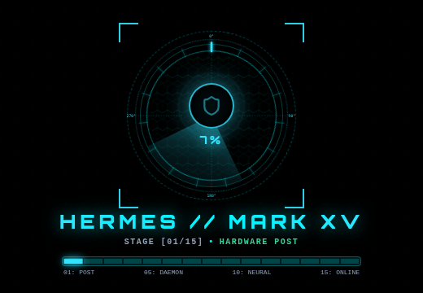
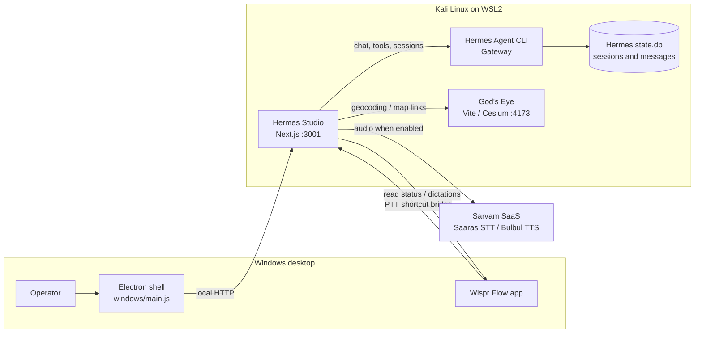
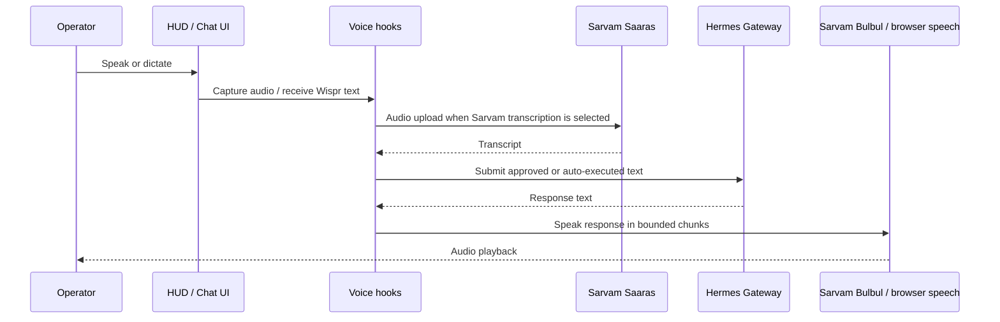

# Hermes Agent OS — Architecture Blueprint

## Product overview

Hermes Agent OS is a locally operated control surface for the Hermes Agent runtime. The UI runs as a Next.js application inside WSL2, while an optional Electron shell runs on Windows and connects to the local Studio server. The system also integrates with a Windows Wispr Flow installation, optional Sarvam speech services, and the separate God's Eye map viewer.

The visual system is the existing black-and-cyan sci-fi HUD. This document describes the current implementation; it does not prescribe a redesign.



## System context



## Runtime services

| Service | Runtime | Default address or data path | Role |
| --- | --- | --- | --- |
| Hermes Studio | Next.js 15 / React 19 | `http://localhost:3001` | HUD/chat UI and server API routes |
| Hermes Gateway | Hermes Agent CLI under the configured Python runtime | Managed by the CLI | Agent inference and tool execution |
| Hermes state | SQLite | `~/.hermes/state.db` | Durable Hermes sessions and message history |
| God's Eye | Vite / Cesium companion project | `http://localhost:4173` | 3D globe, geocoding, and target visualization |
| Electron shell | Electron 44 | Windows app | WSL service startup, local window, audio and browser integration |
| Wispr Flow | Windows desktop app | Installed Windows profile | Dictation and push-to-talk source |
| Sarvam speech | HTTPS API | `api.sarvam.ai` | Optional cloud speech recognition and synthesis |

`scripts/manage-services.sh` starts the Gateway, God's Eye, and Studio. It runs the production Studio server when `.next/` exists and uses the dev server when it does not. The Windows scripts launch the Electron shell and coordinate the WSL side.

## Application paths

```mermaid
flowchart TD
  Page[src/app/page.tsx] --> HUD[src/components/os/hud.tsx]
  Page --> Chat[src/components/os/chat-mode.tsx]
  Chat --> VoiceHook[src/hooks/use-real-voice.ts]
  Chat --> WisprHook[src/hooks/use-wispr-flow.ts]
  VoiceHook --> SarvamLib[src/lib/sarvam.ts]
  WisprHook --> WisprLib[src/lib/wispr-flow.ts]
  Chat --> HermesLib[src/lib/hermes.ts]
  HUD --> MetricsHook[src/hooks/use-system-metrics.ts]
  HermesLib --> HermesRoutes[/api/hermes/*]
  SarvamLib --> SarvamRoutes[/api/sarvam/*]
  WisprLib --> SystemRoutes[/api/system/*]
  MetricsHook --> SystemRoutes
  Chat --> GodseyeLib[src/lib/godseye.ts]
  GodseyeLib --> GodseyeRoutes[/api/godseye/*]
```

### Chat and session restore

1. Chat Mode sends the prompt and optional session ID to `POST /api/hermes/chat`.
2. `src/lib/hermes.ts` invokes Hermes CLI and returns the active session ID.
3. Hermes persists session and message history in `~/.hermes/state.db`.
4. The app saves the active session ID and selected view (`chat` or `hud`) in same-origin `localStorage`.
5. On startup, it opens that session. On a first run without a saved selection, it chooses the latest session returned by `GET /api/hermes/sessions`.
6. `GET /api/hermes/session-messages?sessionId=...` restores messages. **New Session** stores an empty current-session selection without deleting older Hermes history.

The local-storage entries are browser-profile-specific. The Electron profile and a regular browser profile do not share preferences or the current-session pointer. The canonical conversation history remains in Hermes' database.

### Voice input and output



- Browser speech recognition is used where available; the Electron flow can record clips and send them to Sarvam STT.
- Sarvam STT defaults to language auto-detection (`unknown`) and accepts supported audio formats up to the route's 20 MB guard. REST transcription is intended for short clips; the capture UI stops at its configured maximum duration.
- TTS supports the configured Bulbul v2/v3/v4-flash models. The route applies model-specific request fields and length limits and splits long replies on the client. Web Speech is a per-chunk fallback if Sarvam playback fails.
- Wispr Flow is polled for installation/running state, keybinds, and new dictations. Dictations can require approval or follow the saved auto-execute setting. PTT uses the configured Wispr shortcut rather than assuming Caps Lock.
- Sarvam speech sends audio/text to the Sarvam service. Use the feature only when that service is configured and appropriate for the content being spoken.

## API route groups

| Route group | Main routes | Responsibility |
| --- | --- | --- |
| `/api/hermes/*` | `chat`, `sessions`, `session-messages`, `status`, `config`, `commands`, `skills`, `gateway` | Chat, persisted Hermes history, CLI configuration, and status |
| `/api/sarvam/*` | `stt`, `tts` | Server-side proxy to the optional Sarvam speech APIs |
| `/api/system/*` | `metrics`, `audio`, `boost`, `exec`, `auto-setup`, `windows-bridge`, `wispr-flow` | WSL telemetry and machine integration |
| `/api/godseye/*` | `status`, `geocode` | Companion viewer health and location lookup |

Routes are under `src/app/api/`. Keep browser-specific or Windows-specific operations behind the corresponding server route or bridge module.

## Persistence and configuration

- **Conversation content:** `~/.hermes/state.db` (managed by Hermes Agent).
- **Current app session and view:** `hermes_last_session_id` and `hermes_app_mode` in browser local storage.
- **Voice/UI preferences:** local-storage entries managed by the voice, Wispr Flow, audio, theme, and settings modules.
- **Sarvam credentials:** browser local storage through `src/lib/sarvam.ts`, or the server environment variable `SARVAM_API_KEY`. `.env*` is ignored by Git.
- **Service logs:** `~/.hermes/run/studio.log`, `godseye.log`, and `gateway.log` when started by the service manager.

There is no account-based cloud sync layer in this repository. Local browser preferences and Hermes' local database remain on the machine unless another configured service exports them.

## Security and trust boundaries

- The service manager binds Studio and God's Eye to `0.0.0.0` for the Windows/WSL bridge. Restrict access at the host firewall and do not publish these unauthenticated ports to the public internet.
- `/api/system/exec` and Hermes tools can run commands in the WSL environment. The desktop UI is intended for a trusted local operator.
- Store API keys in local settings or an ignored environment file. Never add secrets, real dictation text, private session content, or system telemetry to screenshots or source control.
- Wispr Flow's local database integration is read-only. Audio sent through Sarvam is processed by Sarvam's cloud API.

## Design invariants

- Preserve the existing black/cyan HUD, Orbitron typography, animated core, panel arrangement, and responsive behavior when making functional changes.
- Keep the HUD and chat as separate app modes with direct navigation between them.
- Keep the current voice approval/auto-execute policy visible and respect the configured activation mode and PTT keybind.
- A new chat changes the active session pointer; it must not erase saved Hermes history.

## Useful commands

From the Studio project root in Kali WSL:

```bash
npm ci
npm run dev
npm run typecheck
npm run lint
npm run build
npm start
scripts/manage-services.sh status
```

See [README.md](../README.md) for setup, desktop launch, and troubleshooting instructions.
